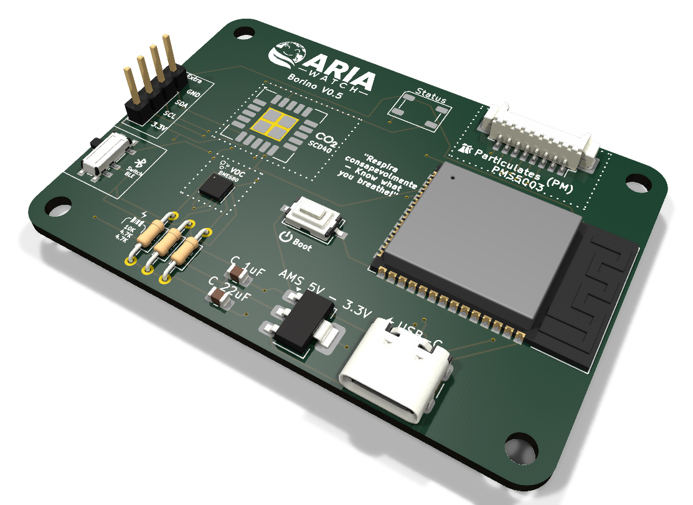
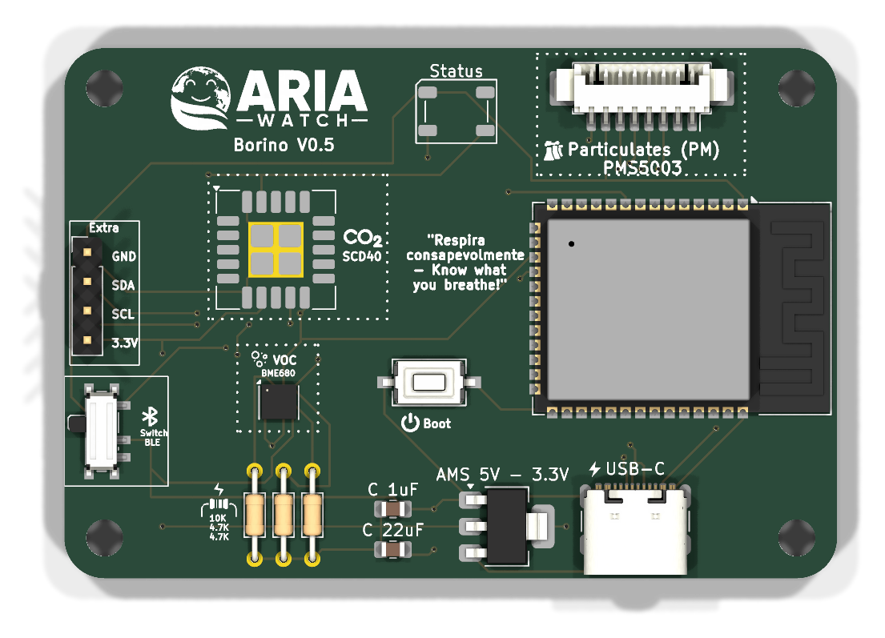
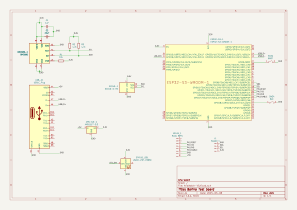

<p align="center">
  <a href="https://aria.watch">
    
  </a>
</p>

<p align="center">
  <strong>Borino: the open-hardware air-quality board of Aria Watch.</strong><br>
  <em>Respira consapevolmente — Know what you breathe!</em>
</p>

<p align="center">
  <a href="https://aria.watch">Website</a> ·
  <a href="https://aria.watch/docs/borino/pcb-assembly/">Assembly guide</a> ·
  <a href="https://github.com/Aria-Watch/AriaWatch-Firmware">Firmware</a> ·
  <a href="docs/3d/borino.stl">3D model</a> ·
  <a href="LICENSE">CERN-OHL-S-2.0</a>
</p>

<p align="center">
  
</p>

---

**Borino** is a small board built around an **ESP32-S3** that measures CO₂, VOC, temperature, humidity and pressure, with an optional particulate-matter sensor. It is powered over USB-C and sends its data over Wi-Fi to the Aria Watch platform. It is designed to be soldered at home.

Aria Watch won the **🏆 first prize for the best project at Maker Faire Trieste 2025**. It is no longer actively developed: the boards, the firmware and the online services are kept as a memento of many weekends spent building them.

## The board

<p align="center">
  
</p>

| | |
|---|---|
| **Version** | V0.5 |
| **Size** | 67 × 46 mm, 2 layers, 1.6 mm, 4 × M3 mounting holes |
| **Microcontroller** | ESP32-S3-WROOM-1 (Wi-Fi + Bluetooth LE, native USB) |
| **CO₂** | Sensirion SCD40 (also temperature and humidity) |
| **VOC** | Bosch BME680 (also temperature, humidity and pressure) |
| **Particulate matter** | Optional PMS5003 on an 8-pin Molex PicoBlade connector |
| **Power** | USB-C, 5 V → 3.3 V with an AMS1117 regulator |
| **Extras** | RGB status LED, Boot button, BLE switch, I²C expansion header |

The firmware lights the status LED **🟢 below 1000 ppm of CO₂**, **🟠 from 1000 to 1499 ppm** and **🔴 from 1500 ppm**.

### Pinout

| Function | ESP32-S3 GPIO | Where |
|---|---|---|
| I²C SDA / SCL | 9 / 10 | SCD40, BME680 and the **Extra** header |
| Status LED data | 16 | Status LED |
| PMS5003 reset / TX / RX / enable | 11 / 12 / 13 / 14 | PicoBlade pins 3 / 4 / 5 / 6 |
| USB D− / D+ | 19 / 20 | USB-C (native USB, used for flashing) |
| Boot | 0 | Boot button |

**Extra header (J1):** GND · SDA · SCL · 3.3 V, for adding more I²C sensors.
**PM connector:** pins 3–6 as above, pin 7 GND, pin 8 +5 V.

### Schematic

<p align="center">
  <a href="docs/images/borino-schematic.svg">
    
  </a>
</p>

### 3D model

- **[`docs/3d/borino.stl`](docs/3d/borino.stl)**: GitHub shows it in an interactive viewer you can rotate and zoom.
- **[`docs/3d/borino.step`](docs/3d/borino.step)**: for CAD programs, handy for designing an enclosure around the board.

## Build your own

1. **Order the PCB:** upload [`production/borino-v0.5-gerber.zip`](production/borino-v0.5-gerber.zip) to any PCB maker (JLCPCB, PCBWay, …). Use 2 layers and 1.6 mm thickness; the other options can stay at their defaults.
2. **Get the parts:** see the [bill of materials](production/borino-v0.5-bom.csv) below. The [assembly guide](https://aria.watch/docs/borino/pcb-assembly/) has links to each component.
3. **Solder it:** follow the [step-by-step guide](https://aria.watch/docs/borino/pcb-assembly/). Some parts are fine-pitch SMD, so it helps to have some soldering experience.
4. **Flash the firmware:** see [AriaWatch-Firmware](https://github.com/Aria-Watch/AriaWatch-Firmware).

### Bill of materials

| Ref | Part | Package | Qty |
|---|---|---|---|
| ESP32-S3-1 | ESP32-S3-WROOM-1 | Module | 1 |
| SCD40-1 | Sensirion SCD40-D-R2 | 10.1 × 10.1 mm | 1 |
| BME680-1 | Bosch BME680 | LGA-8 3 × 3 mm | 1 |
| AMS-3.3-1 | AMS1117-3.3 regulator | SOT-223 | 1 |
| C1 / C2 | 1 µF / 22 µF capacitors | 0805 | 2 |
| R1 | 10 kΩ resistor | Axial THT | 1 |
| R2, R3 | 4.7 kΩ resistors | Axial THT | 2 |
| STATUS_LED1 | RGB LED | PLCC-4 5 × 5 mm | 1 |
| USB-C1 | USB-C receptacle GCT USB4105 | SMD | 1 |
| SW2 | Slide switch (BLE) | PCM12 | 1 |
| SW3 | Tactile button (Boot) | PTS636 | 1 |
| MOLEX_1 | Molex PicoBlade 8-pin, horizontal | 53261-0871 | 1 |
| J1 | Pin header 1×4, 2.54 mm | THT | 1 |

The PMS5003 sensor and its cable are optional and connect to MOLEX_1.

## Known issues

These are left as they are in V0.5, as part of the project's history. Worth fixing if you make a new revision:

- **No 5.1 kΩ pull-down resistors on the USB-C CC pins.** USB-C chargers and ports connected with a C-to-C cable will not turn on the 5 V supply. Use a **USB-A to USB-C cable** to power and flash the board.
- **No input capacitor on the AMS1117 5 V input**, and **no RC delay on the ESP32 EN pin** (it is tied directly to 3.3 V). The board works without them, but both are recommended by the datasheets.
- **The schematic leaves USB-C pins B6/B7 unconnected**, while the PCB correctly ties them to D+/D−, so USB works with the plug in either orientation. Update the schematic before your next revision.
- **DRC reports only cosmetic and manufacturing warnings**: small silkscreen text, the 0.2 mm thermal vias of the standard ESP32-S3 footprint, and two mounting holes near the antenna keep-out area. The board has been manufactured and works as it is.

No shorts: KiCad's design rule check finds no copper touching between different nets and no unconnected pads, and the board's connections match the schematic pin by pin. Earlier revisions had two shorts near the USB-C connector, fixed since January 2025.

## Open the project

The design is made with **[KiCad 9](https://www.kicad.org/)**. Open `AriaWatch-V5.kicad_pro`.

```
├── AriaWatch-V5.kicad_pro / .kicad_sch / .kicad_pcb   # KiCad project, schematic and PCB
├── Custom.pretty/        # Silkscreen icons (CO₂, VOC, PM, BLE, power…)
├── AriaWatchLib.pretty/  # Aria Watch logo footprint
├── production/           # Gerber files and bill of materials, ready to order
├── docs/
│   ├── images/           # Renders and schematic used in this README
│   └── 3d/               # STL and STEP models of the assembled board
└── tools/
    └── kicad-resize-footprint.py   # Script used to scale the silkscreen icons
```

Everything else uses the standard KiCad libraries. The SCD40 and the status LED have no 3D model in the KiCad library, so they don't appear in the renders.

## License

Copyright © 2024–2025 Aria Watch.

This source describes Open Hardware and is licensed under the **[CERN Open Hardware Licence Version 2 – Strongly Reciprocal](LICENSE)** (CERN-OHL-S-2.0).

You may redistribute and modify this source and make products using it under the terms of the CERN-OHL-S v2. In short: if you share a modified version or sell boards based on it, you must share your design files under the same licence.

This source is distributed **without any express or implied warranty**, including of merchantability, satisfactory quality and fitness for a particular purpose. Please see the [licence](LICENSE) for the applicable conditions.

**Source location:** <https://github.com/Aria-Watch/Aria-Watch-Borino-PCB>. As per section 4 of the licence, if you make hardware based on this source, keep this source location visible on the product or its enclosure where practicable.

---

<p align="center">
  Made with 💚 in Italy · <a href="https://aria.watch">aria.watch</a>
</p>
